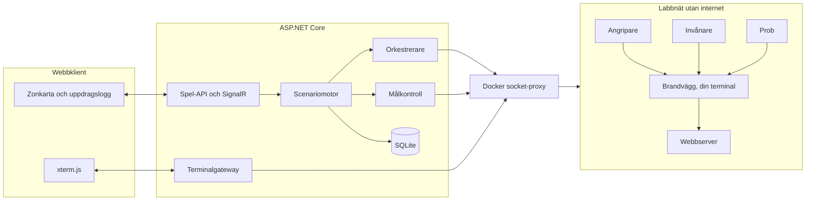

# Azeroth SOC – designdokument fas 1

2026-11-16 · Ludvig

Exporterat från det levande dokumentet: https://claude.ai/artifact/W7T4F6N9GJxDfafpp3XCfM

## Frågor och antaganden

Designen bygger på antagandena i högerkolumnen. Svara på frågorna så justerar jag det som ändras. Lärmålen stod kvar som platshållare i prompten, så fråga 1 är viktigast.

| # | Fråga | Antagande tills du svarar |
| --- | --- | --- |
| 1 | Vilka är dina lärmål, i prioritetsordning? Siktar du på en certifiering? | Exempellistan gäller, i den här ordningen: brandväggar, segmentering, logganalys, IDS, incidenthantering, kryptografi. Ingen certifiering styr. |
| 2 | Hur van är du vid Linux-terminalen och TCP/IP i dag? | Du klarar grundläggande shell och vet vad portar och IP-adresser är, men har inte skrivit brandväggsregler för hand. |
| 3 | nftables eller iptables som huvudverktyg? | nftables. Det är standard i moderna distributioner och har JSON-utdata som gör målkontrollen enklare. |
| 4 | Var ska spelet köras? | Utveckling på din Windows 11-dator (x86-64, Docker Desktop med WSL 2), senare flytt till en egen Linux-VM i Proxmox. |
| 5 | Vill du ha en värld att gå runt i, eller räcker en karta med uppdrag? | MVP:n har en skärm: zonkarta, uppdragslogg, terminal och status. En värld att gå runt i kommer först när kärnloopen är rolig. |

Övriga antaganden:

- En spelare, ett scenario i taget. Ingen inloggning, inget konto.
- WoW-temat finns bara som text i en temafil. All grafik är egen eller fritt licensierad.
- Spelpass på 20 till 40 minuter. Ett scenario ska gå att klara på ett pass.

## Speldesign

Spelet är en serie försvarsuppdrag där din enda väg framåt är att konfigurera riktiga system rätt. Spelet dömer resultatet genom att skicka riktig trafik och se vad som händer.

### Kärnloopen

1. **Uppdrag.** En quest-givare beskriver hotet i världens språk och målet i tekniska termer.
2. **Rekognosering.** Du undersöker miljön i terminalen: gränssnitt, lyssnande portar, loggar. Ingen tidspress.
3. **Förberedelse.** Du bygger försvaret. Klockan står still tills du själv ringer i klockan.
4. **Våg.** Angripare och vanliga invånare skickar riktig trafik i 60 till 120 sekunder. Du ser effekten live och får justera.
5. **Dom.** Spelet mäter vad som faktiskt slapp igenom och ger betyg, erfarenhet och en kort genomgång av vad som hände på nätet.

Två mätare avgör varje våg. **Stadens hälsa** är andelen legitima anrop som lyckas. **Intrång** är varje angreppspaket som når något det inte borde nå. Att blockera allt sänker hälsan till noll, så den lata lösningen förlorar alltid.

### Koppling till lärmålen

| Klass | Lärmål | Riktiga verktyg | Så kontrolleras det |
| --- | --- | --- | --- |
| Warrior | Brandväggar, segmentering | nftables, ip, ss, tcpdump | Probtrafik från angripare och invånare, mätt i båda ändar |
| Priest/Paladin | Logganalys, incidenthantering | journalctl, grep, jq, Suricata-larm | Du pekar ut rätt värd, tidpunkt och ingångsväg; den smittade värden är isolerad |
| Rogue | Rekognosering, sårbarhetsanalys | nmap, curl, dig | Du rapporterar rätt öppna tjänster och svagheter hos ett labbmål |
| Mage | Kryptografi, PKI | openssl, ssh-keygen, WireGuard | Certifikatkedjan validerar; tunneln bär trafik; klartext syns inte i tcpdump |

### Zoner och progression

| Zon | Nätverk | Vad du lär dig | Fiender |
| --- | --- | --- | --- |
| Elwynn Forest | Ett platt hemnät | Läsa av ett nät: adresser, portar, vad som lyssnar | Nyfikna spejare som bara tittar |
| Westfall | DMZ med en publik webbserver | Default deny, minsta öppning, rate limiting | Defias-spejare, inbrottsförsök, svärmar |
| Stormwind | Internt nät med flera segment | Segmentering mellan distrikt, loggning, IDS | En farsot som sprider sig mellan osegmenterade distrikt |
| The Deadmines | Datacenter, raid | Hela incidentkedjan under tidspress | Defias som hotgrupp i fem faser |

Du börjar som Warrior. Övriga klasser låses upp av zonerna: Priest i Stormwind, Rogue och Mage därefter. I raiden byter du klass mellan faserna, och varje fas kräver den klassens verktyg.

Talangträdet är din färdighetskarta. En nod tänds först när du klarat en kontroll utan ledtråd, så trädet visar vad du faktiskt kan.

### Vad som gör det roligt

- **Du ser trafiken.** Angripare och invånare rör sig på zonkartan i takt med de riktiga paketen. En tappad regel syns direkt som fiender innanför muren.
- **Fienden anpassar sig.** Nästa våg går på det du lämnade öppet. Samma uppdrag spelas olika beroende på ditt försvar.
- **Genomgången efteråt.** Du får en tidslinje över vad som hände och vilken regel som stoppade vad. Det är där det mesta lärandet sker.
- **Repetition med variation.** Adresser, portar och angreppsordning slumpas per försök, så du kan inte skriva av förra gångens lösning.

## Arkitektur

All spellogik ligger i en ASP.NET Core-backend som styr Docker. Klienten är en tunn webbsida med karta och terminal.

### Val av stack

| Del | Val | Varför |
| --- | --- | --- |
| Klient | Webb: TypeScript, Phaser 3 för kartan, xterm.js för terminalen | Terminalen är spelets viktigaste yta och xterm.js är en färdig, riktig terminal. I Godot eller Unity måste du bygga en egen terminalemulator. |
| Backend | ASP.NET Core, SignalR, Docker.DotNet | Din hemmaplan. Scenariomotor, målkontroll och progression blir vanlig, testbar C#. |
| Lagring | SQLite | En spelare. Ingen databasserver behövs. |
| Scenarion | YAML-filer i repot | Nytt innehåll utan kodändring; går att versionshantera och granska. |
| Tema | `theme-wow.json` | Namn, dialog och lore byts utan att röra logiken. |

Klienten blir det enda som inte är C#. Den är liten: den ritar tillstånd som backend skickar och innehåller inga regler.

### Komponenter och dataflöde



Scenariomotorn är en tillståndsmaskin: rekognosering, förberedelse, våg, dom. Den ber orkestreraren starta och stoppa trafikkällor, ber målkontrollen mäta och skickar händelser till klienten via SignalR. Terminalgatewayen kopplar en WebSocket till `docker exec` med TTY i din container, och ingenting annat.

### Containrarnas livscykel

1. **Skapa.** Orkestreraren läser scenariots YAML, skapar nät och containrar och märker allt med ett körnings-id.
2. **Slumpa.** Adresser, portar och angreppsordning väljs per körning och skickas in som miljövariabler.
3. **Kör.** Trafikkällorna startas och stoppas per våg. Din container lever hela scenariot.
4. **Återställ.** Allt med körnings-id:t tas bort och skapas om från avbilderna. Inget tillstånd överlever.
5. **Städa.** Vid uppstart tar backend bort alla kvarlämnade labbresurser, och varje körning har en maxtid.

### Isolering

- Labbnäten skapas med `internal: true`. De har ingen väg ut, varken till internet eller till ditt hemnät.
- Din container får `NET_ADMIN` och inget mer. Övriga capabilities tas bort, `no-new-privileges` är på, aldrig `--privileged`.
- Gränser för CPU, minne och antal processer på varje container.
- Ingen labbcontainer ser Docker-socketen. Backend når Docker via en socket-proxy som bara släpper igenom de API-anrop som behövs.
- Backend lyssnar bara på localhost under utveckling. I Proxmox körs allt i en egen VM på ett eget VLAN där brandväggen nekar utgående trafik.
- Angreppsverktygen finns bara i angriparcontainrarna, och de har bara labbnätet att nå.

### Målkontroll

Principen är att döma beteende och inte syntax. Det finns många rätta sätt att skriva en regel, så spelet frågar aldrig hur regeln ser ut utan vad den gör.

| Typ | Vad den gör | Används till |
| --- | --- | --- |
| Prob | En egen container skickar testtrafik från angriparens och invånarnas adresser och noterar vad som kommer fram | Godkänt eller underkänt |
| Mätning | Webbserverns åtkomstlogg räknas per källadress under vågen | Stadens hälsa och intrång |
| Tillstånd | `nft -j list ruleset` läses ur din container | Återkoppling och val av ledtråd, aldrig betyg |

Du är root i brandväggscontainern. Därför kommer alla betygsgrundande mätvärden från containrar du inte har skal i. Varje kontroll är en C#-klass bakom ett gemensamt gränssnitt och deklareras i scenariots YAML:

```yaml
checks:
  - id: only-web-open
    type: probe.ports
    from: attacker
    target: web
    expect_open: [80, 443]
  - id: citizens-served
    type: measure.success_rate
    from: citizens
    min: 0.95
```

## MVP-scope

Ditt förslag håller: en zon, en klass, tre vågor mot en webbserver. Jag ändrar fyra saker.

| Ditt förslag | Min ändring | Varför |
| --- | --- | --- |
| Regler skrivs i realtid under attack | Förberedelsefas utan klocka före varje våg | Att lära sig syntax under tidspress lär ut stress, inte brandväggar. Pressen kommer i vågen, när du justerar. |
| Bara angripare | Invånare som måste komma fram | Utan legitim trafik vinner "blockera allt". Avvägningen är själva yrket. |
| Tre vågor direkt | En våg noll som är ren rekognosering | Du måste kunna läsa av nätet innan du kan försvara det. |
| En spelvärld | En enda skärm | Världen bevisar inget om kärnloopen och kostar mest att bygga. |

MVP:n innehåller:

- Ett scenario, "Försvara Sentinel Hill", med våg noll och tre vågor.
- En skärm med fyra ytor: zonkarta med trafik, uppdragslogg, terminal och mätare för hälsa och intrång.
- Orkestrering, terminal, tre typer av målkontroll och ledtrådar i tre nivåer.
- Genomgång efter varje våg och sparad historik per försök.

MVP:n innehåller inte: fler klasser, talangträd, raid, automatiserad motståndare som anpassar sig, ljud eller animerade figurer. Målet är att svara på en fråga: är det roligt att spela samma scenario en tredje gång?

## Första scenariot: Försvara Sentinel Hill

Du är Warrior och vaktar porten mellan Westfalls slätter och Sentinel Hill. Gryan Stoutmantle ger uppdraget: stadens anslagstavla (webbservern) ska vara öppen för invånarna, och Defias ska inte komma åt något annat.

### Uppsättning

| Container | Nät | Roll | Har du skal? |
| --- | --- | --- | --- |
| `gate` | Slätten och DMZ | Router med nftables, tcpdump, ss, ip. Startar med tom regeluppsättning och allt tillåtet. | Ja |
| `web` | DMZ | nginx på 80, sshd på 22 för förvaltning, en kvarglömd felsökningssida på 8080, en databas på 3306 | Nej |
| `citizens` | Slätten | Skickar vanliga webbanrop i jämn takt | Nej |
| `garrison` | Slätten | Gryans förvaltningsvärd, den enda som ska nå port 22 | Nej |
| `defias` | Slätten | Angripare med skriptad trafik per våg | Nej |
| `probe` | Slätten | Målkontrollens testtrafik | Nej |

All trafik mellan slätten och DMZ går genom `gate`. Du når aldrig `web` direkt, så enda sättet att skydda den är reglerna i porten. Svar lämnas med kommandot `quest` i terminalen, till exempel `quest report`.

### Vågorna

| Våg | Vad som händer | Vad du behöver lära dig | Godkänt när |
| --- | --- | --- | --- |
| 0. Kartlägg porten | Ingen attack. Du undersöker gränssnitt och flöden och lyssnar med tcpdump. | Läsa av ett nät: vilka nät finns, vad passerar, vilka portar svarar | Du rapporterar rätt nät och rätt fyra tjänster på `web` |
| 1. Spejarna | Defias kartlägger allt som går att nå genom porten | Default deny, tillåt etablerade flöden, öppna bara det som ska vara publikt | Proben når bara 80 från angriparens adress; invånarna lyckas till minst 99 % |
| 2. Inbrottet | Upprepade inloggningsförsök mot förvaltningsporten från flera adresser | Regler per källadress; förvaltning bara från betrodd värd | Port 22 svarar för `garrison` och ingen annan; invånarna opåverkade |
| 3. Svärmen | En flod av webbanrop från tre adresser som byter adress halvvägs | Rate limiting per källa i stället för att jaga enskilda adresser | Invånarna lyckas till minst 95 %; ingen källa får igenom mer än 20 anrop per sekund |

`web` har medvetet liten kapacitet, så svärmen slår ut invånarna om du inte gör något. Adressbytet i våg 3 gör att spärrlistor för hand misslyckas, och det är lektionen.

### Ledtrådar

Varje våg har tre nivåer. Varje använd nivå drar av erfarenhet, och talangnoden tänds bara utan ledtråd. Exempel för våg 1:

1. **Begrepp.** "En port som släpper igenom allt som inte är förbjudet har du redan förlorat. Vänd på det."
2. **Verktyg.** "Titta på kedjan för vidarebefordrad trafik och dess policy. Glöm inte svaren på flöden du redan släppt in."
3. **Skelett.** En regeluppsättning med luckor: kedjan och policyn är utskrivna, men matchningarna får du fylla i själv.

Tillståndskontrollen väljer ledtråd efter vad du faktiskt har. Har du rätt policy men saknar regeln för etablerade flöden får du en ledtråd om just det.

### Genomgången

Efter varje våg visas en tidslinje: vad angriparen försökte, vad som stoppades av vilken regel (från regelräknarna) och vad som kom fram. Sist kommer en fråga att fundera på till nästa våg, till exempel "Vem mer än invånarna behöver nå den här servern?"

## Repostruktur och plan för fas 2

Bygg nedifrån: först labbet och målkontrollen utan någon grafik, sist klienten. De tre första stegen avgör om idén håller.

```text
azeroth-soc/
  CLAUDE.md                 stack, beslut, säkerhetskrav
  docs/design.md            det här dokumentet
  src/
    Game.Api/               ASP.NET Core, SignalR, terminalgateway
    Game.Core/              scenariomotor, progression, domänmodell
    Game.Orchestration/     Docker.DotNet, nät, livscykel
    Game.Checks/            prob, mätning, tillstånd
    Game.Cli/               kör ett scenario utan klient
  client/                   TypeScript, Phaser, xterm.js
  lab/
    images/                 gate, web, citizens, garrison, defias, probe
    scenarios/              sentinel-hill.yaml
  themes/theme-wow.json
  tests/
    Game.Core.Tests/
    Game.Checks.Tests/      kör mot riktiga containrar
```

1. **Labbet för hand.** Bygg avbilderna och starta topologin med en compose-fil. Skriv reglerna själv och se att routing, nftables och tcpdump fungerar på din dator. Klart när: du kan spärra port 22 i `gate` och se det från `probe`.
2. **Orkestreraren.** Skapa, slumpa, återställ och städa via Docker.DotNet och socket-proxyn. Klart när: `Game.Cli up` och `Game.Cli reset` fungerar tio gånger i rad utan kvarlämnade resurser.
3. **Målkontrollen med tester.** De tre kontrolltyperna, och för varje våg minst en rätt lösning som ska godkännas och tre felaktiga som ska underkännas. Klart när: testerna är gröna mot riktiga containrar.
4. **Isoleringstester.** Automatiska tester som försöker nå internet, hemnätet och Docker-socketen inifrån varje container. Klart när: alla försök misslyckas.
5. **Scenariomotorn.** Tillståndsmaskinen, YAML-laddning, vågornas trafik, poäng och ledtrådar. Klart när: hela Sentinel Hill går att spela i `Game.Cli` med `docker exec` som terminal.
6. **Terminalgatewayen.** WebSocket till `docker exec` med TTY, storleksändring och återanslutning. Klart när: en tom webbsida med xterm.js ger ett fungerande skal.
7. **Klienten.** Skärmen med fyra ytor, trafik på kartan från mätvärdena, genomgången efter varje våg. Klart när: du spelar hela scenariot i webbläsaren.
8. **Tema och historik.** Temafilen kopplas in, försök sparas i SQLite, en enkel progressionsvy. Klart när: du kan byta till ett neutralt tema med en konfigurationsrad.
9. **Flytt till Proxmox.** Samma compose-uppsättning i en Linux-VM på eget VLAN. Klart när: isoleringstesterna är gröna där också.

Spela själv efter steg 5. Är scenariot inte roligt i en ren terminal räddar inte grafiken det.

## Risker och svåra problem

Den största risken är en målkontroll som godkänner fel lösning, eftersom spelet då lär ut fel saker med gott självförtroende.

| Område | Risk | Åtgärd |
| --- | --- | --- |
| Pedagogik | Kontrollen godkänner en regel som inte skyddar, eller underkänner en som gör det | Döm beteende med probtrafik. Testsvit med rätta och felaktiga lösningar per våg (steg 3). |
| Pedagogik | Du lär dig scenariot utantill i stället för färdigheten | Slumpade adresser, portar och angreppsordning. Senare scenarion kräver samma färdighet i ny miljö. |
| Pedagogik | Ledtrådarna blir ett facit | Nivå 3 har luckor, kostar erfarenhet och släcker talangnoden. |
| Pedagogik | Det blir en labb med fantasynamn och inget spel | Spela i terminalen efter steg 5. Trafiken på kartan och genomgången är det som ska bära känslan. |
| Teknik | nftables i en container på Windows beror på WSL 2-kärnan; moduler för rate limiting kan saknas | Verifiera i steg 1, innan någon kod skrivs. Faller det, utveckla mot Proxmox-VM:en från start. |
| Teknik | Kärnloggning från regler når normalt inte ut ur en containers nätverksnamnrymd | Räkna med regelräknare och webbserverns logg. Logguppgifter läggs på Suricata i senare scenarion. |
| Teknik | Mätningarna i våg 3 varierar med maskinens last, så samma försvar får olika betyg | Låg, fast anropstakt och hårda resursgränser på `web`. Marginal i trösklarna. Kör testerna 20 gånger och kräv samma utfall. |
| Teknik | Du låser ute dig själv eller kontrollen med en regel | Terminalen går via `docker exec`, inte via nätet. Återställning är alltid ett klick bort. |
| Säkerhet | Trafik läcker från labbnätet till hemnätet eller internet | `internal: true`, isoleringstester i steg 4, egen VM och eget VLAN med nekad utgående trafik. |
| Säkerhet | `NET_ADMIN` ger mer makt än ett vanligt skal | Bara i `gate`, bara labbnät anslutna, inga andra capabilities, ingen värdnätverksdelning. |
| Säkerhet | Backend styr Docker och är därmed root på värden | Socket-proxy med vitlista, backend bara på localhost, ingen annan tjänst i samma VM. |
| Säkerhet | Angreppsverktygen används utanför labbet av misstag | De finns bara i angriparavbilderna och målen är hårdkodade till labbnätens adressrymd. |
| Omfång | Projektet sväller innan något är spelbart | Inget utanför MVP-listan förrän Sentinel Hill är spelat tre gånger. |

Två saker är olösta och bör bestämmas efter MVP:n:

- **Den automatiserade motståndaren.** En skriptad angripare är förutsägbar; en som anpassar sig är svår att göra rättvis och att testa. Första steget är regler av typen "gå på det som lämnats öppet".
- **Raiden som ensamspelare.** Klassbyte mellan faser fungerar på papper, men måste provas så att det inte blir fem separata uppdrag efter varandra.
